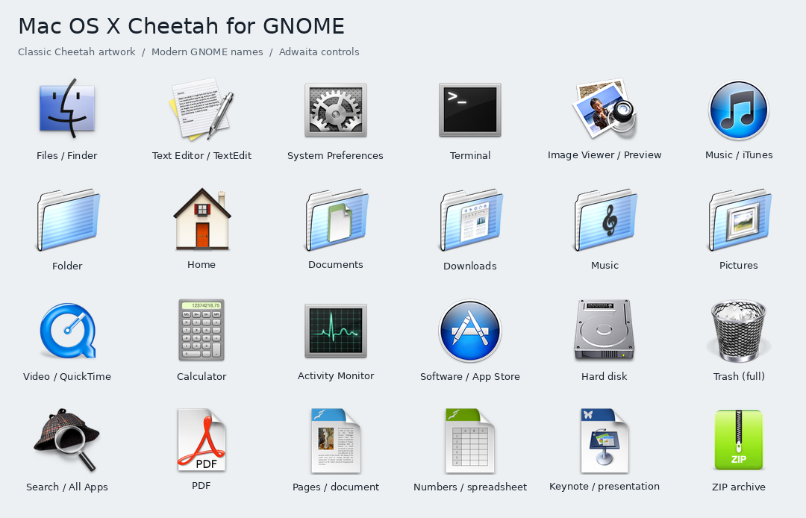

# Cheetah-GNOME

A Mac OS X Cheetah icon theme for GNOME, with striped blue folders, broad application coverage, and Adwaita controls.

The icon artwork is from **[b00merang / B00merang Artwork](https://github.com/B00merang-Artwork/Mac-OS-X-Cheetah)**, including the All Apps artwork. The upstream adaptation credits Elbullazul and its Mac-X-Lion origins. See [SOURCE.md](SOURCE.md).

## Download and use

Download `Cheetah-GNOME.tar.xz` from the [latest release](https://github.com/daffarahman/Cheetah-GNOME/releases/latest).
With Adwaita installed, extract the archive and select the theme:

```sh
mkdir -p ~/.local/share/icons
tar -xJf Cheetah-GNOME.tar.xz -C ~/.local/share/icons
gtk-update-icon-cache -f ~/.local/share/icons/Cheetah-GNOME
gsettings set org.gnome.desktop.interface icon-theme Cheetah-GNOME
```

## Get the build sources

```sh
git clone --recurse-submodules https://github.com/daffarahman/Cheetah-GNOME.git
cd Cheetah-GNOME
```

Python 3, Pillow (listed in `requirements.txt`), and an installed Adwaita icon
theme are required to build. The `artwork/` directory supplies the source images.
The b00merang source is pinned as a Git submodule. If you cloned without
`--recurse-submodules`, run `git submodule update --init` before building.

The build, installation, and verification tools share their approach with
[Lion-GNOME](https://github.com/daffarahman/Lion-GNOME).



## Included artwork

- 953 application mappings with modern GNOME names, including Files, Text Editor,
  Settings, Terminal, image and document viewers, music, video and system tools.
- 13 folder and location designs, including the Cheetah pack's striped blue
  folders, home, network folders and empty/full Trash.
- Five drive/disc designs and 18 file-type designs.
- The supplied `128x128/apps/panel-searchtool.png` artwork for Dash to Dock's
  All Apps button; clicking it opens GNOME's application grid.

Text Editor uses the supplied pen-and-paper TextEdit artwork
(`128x128/apps/package_editors.png`). The source's `accessories-text-editor` image
depicts Pages instead; that icon name is mapped to TextEdit in this build.

The Desktop folder uses `128x128/places/folder-desktop.png`, the supplied Cheetah
desktop artwork. GNOME's `user-desktop` name and its aliases all use this image;
the source's `user-desktop.png` depicts a later macOS desktop.

Visual Studio Code uses this source pack's blueprint-and-hammer Xcode artwork
(`128x128/apps/applications-development.png`), mapped to `vscode` and common
VS Code icon names.

Shelly uses `128x128/apps/package_utilities.png`, mapped to `shelly` and
`com.shellyorg.shelly`.

The app mappings cover **1,101 names** from the source's `128x128/apps` PNGs,
including Pitivi, Blender, VLC, Audacity, OpenShot, Thunderbird and KDE apps.
An additional 93 modern application IDs are matched using the locally cached
AppStream catalog. Existing generic aliases now use each app's own supplied
artwork where available, including XTerm, Ark, Totem, Vinagre, KCalc, Disks and
Disk Usage Analyzer. The TextEdit choices above are retained.

There are **1,518 icon names**, including aliases and the All Apps icon. Fixed-size
RGBA PNGs are generated at 16, 22, 24, 32, 48, 64, 96 and 128 pixels. Artwork is
downsampled without stretching or upscaling. Larger requests can scale the
available artwork. A few supplied app images are smaller than 128 pixels;
those omit larger output sizes and use the nearest available image on lookup.

The supplied Cheetah repository shares many app images with its Lion counterpart,
including some designs from later macOS releases. This build uses the supplied
images as they are, with the Cheetah-specific folder artwork. It does not claim
to be a reconstruction of every icon shipped in OS X 10.0.

Adwaita supplies symbolic toolbar/sidebar icons, status indicators, window buttons
and artwork without an explicit mapping. The builder checks aliases against
inherited action, status, emblem and UI names. The full Trash location and the
session-specific All Apps icon are intentional exceptions; the shared app-grid
control remains inherited.

## Build, install and select

Requires Python 3, Pillow and an installed Adwaita icon theme. Initialize the `artwork/` Git submodule before rebuilding. The original sibling
`Mac-OS-X-Cheetah` folder is also supported for older local checkouts. Once the sources are checked out, no downloads or
administrator privileges are needed.

From this directory:

```bash
python3 sync_apps.py               # Refresh source names and cached app-ID matches
python3 build_theme.py             # Build and render preview.png / overview.png
python3 build_theme.py --install   # Install for the current user
python3 build_theme.py --activate  # Install and select in GNOME
python3 build_theme.py --restore   # Restore the saved icon theme and launchers
```

The build is `build/Cheetah-GNOME`. Installation uses
`~/.local/share/icons/Cheetah-GNOME`, respecting `XDG_DATA_HOME`, and refreshes the
GTK icon cache. Activation saves the previous icon, GTK and window theme settings
in `previous-settings.json`, then selects the icon theme.

Select **Cheetah-GNOME** in GNOME Tweaks, or restore your saved theme:

```bash
python3 build_theme.py --restore
```

Existing Lion-GNOME and Win7-GNOME launcher aliases are supported. On another
desktop, installation creates a user-local launcher override only if Print
Settings, HP Scan or HP Device Manager needs one. HP Device Manager's supplied
launcher uses an absolute icon path, so its override enables theme lookup.
Any previous user-local launcher is saved in
`launcher-backups.json`. `--restore-launchers` restores just those overrides
while preserving subsequent icon edits.

Apps that cache their artwork may need to be reopened. Absolute icon paths and
embedded artwork can bypass themes.

## Coverage and verification

`icons.json` records each design's source path and aliases. `dock-source.json`
records the All Apps source, pinned repository commit and SHA-256. The generated
`coverage.json` lists visible installed launchers and their artwork or fallback.
`app-source-coverage.json` accounts for all 1,152 source app PNG names: 1,101
mapped, 49 reserved for inherited controls, one broken source symlink
(`jscalibrator.png`), and one name containing whitespace (`display capplet.png`)
that GTK's cache rejects. The valid `display-capplet.png` is included. The report
also records the catalog and installed-launcher matches.
The synchronization tool preserves explicit TextEdit overrides, matches whole
names rather than substrings, and requires agreement between catalog app names
and IDs. Rebuilding does not require the catalog or network access.

The verifier requires PyGObject and the corresponding GTK version. It checks
every generated icon and alias through GTK at all eight sizes and scale factors
1 and 2, compares PNG pixels to the specified source artwork, checks source app
name coverage, compares inherited controls against Adwaita, and checks unmatched
app fallbacks:

```bash
python3 sync_apps.py --check
python3 verify_theme.py --gtk-version 3.0
python3 verify_theme.py --gtk-version 4.0
python3 verify_theme.py --gtk-version 4.0 --theme-dir ~/.local/share/icons/Cheetah-GNOME
```

The portable `dist/Cheetah-GNOME.tar.xz` contains the built theme, relative aliases,
attribution, source manifests and previews. Extract it under
`~/.local/share/icons/`, run
`gtk-update-icon-cache -f ~/.local/share/icons/Cheetah-GNOME`, then select the theme.
The source folder and Python packages are needed only for rebuilding.

See [SOURCE.md](SOURCE.md) for attribution and [preview.png](preview.png) for all
designs.
